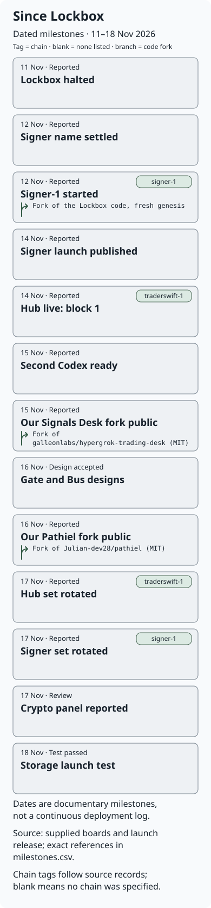
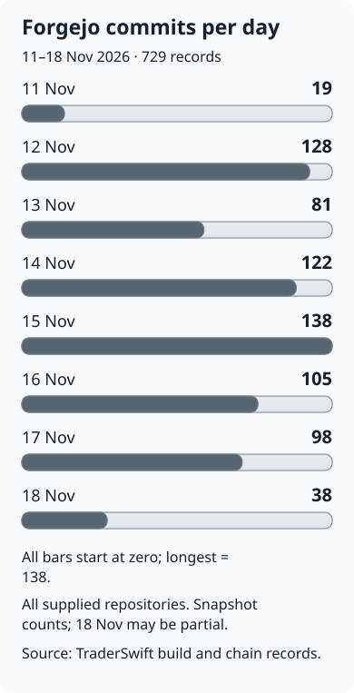

On 11 November we halted our first chain, Lockbox, and archived it. Seven days later, we have a new signing chain with live orders behind it, a hub chain, a wallet design, our own sign-in, a storage chain that passed its first launch test, and a build line where most of the code is written by Codex.

This guide walks through that week: what we built, what broke, and what we changed because of it. Where something is a design and not yet running, it says so.

## The week at a glance

Across all our repositories there are 729 commit records between 11 and 18 November. The busiest day was 15 November, with 138. These are commit records, not features; one fix can take several commits, and the last day is partial.

## Chapters

1. [What happened to Lockbox?](01-what-happened-to-lockbox.md)
2. [What is signer-1, and what did it do this week?](02-what-is-signer-1-and-what-did-it-do-this-week.md)
3. [What is the hub, traderswift-1?](03-what-is-the-hub-traderswift-1.md)
4. [How did Codex become our main builder?](04-how-did-codex-become-our-main-builder.md)
5. [What is the wallet, and why does it have no seed phrase?](05-what-is-the-wallet-and-why-does-it-have-no-seed.md)
6. [Why did we build our own sign-in?](06-why-did-we-build-our-own-sign-in.md)
7. [What are Signals and the desk?](07-what-are-signals-and-the-desk.md)
8. [What else did we start? Storage, the Bus, payments and more](08-what-else-did-we-start-storage-the-bus-payments.md)
9. [What did we move onto our own servers?](09-what-did-we-move-onto-our-own-servers.md)
10. [What went wrong, and what did we change?](10-what-went-wrong-and-what-did-we-change.md)
11. [What is next?](11-what-is-next.md)
12. [Final thoughts](12-final-thoughts.md)
