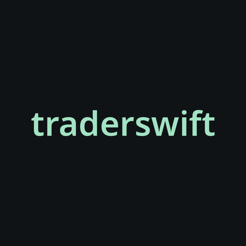

TraderSwift is the infrastructure layer for agentic trading.

It is a set of open-source blockchains and services that trading agents, and the people who run them, can build on.

Others build the front ends and the apps on top. They get paid through x402, with the full payment going directly to them.

This update explains what that means. It shows what is running today, what is being built, and what is still a plan.

It is updated as each part goes live.

## Chapters

1. [What is TraderSwift?](01-what-is-traderswift.md)
2. [Where is trust not required?](02-where-is-trust-not-required.md)
3. [Why is TraderSwift open source?](03-why-is-it-open-source.md)
4. [Who is TraderSwift for?](04-who-is-it-for.md)
5. [How are trading keys held today, and what goes wrong?](05-how-are-trading-keys-held-today.md)
6. [How does Signer work?](06-how-does-signer-work.md)
7. [What is running today?](07-what-is-running-today.md)
8. [What is in the pipeline?](08-what-is-in-the-pipeline.md)
9. [How will we teach it?](09-how-will-we-teach-it.md)
10. [Final thoughts](10-final-thoughts.md)
